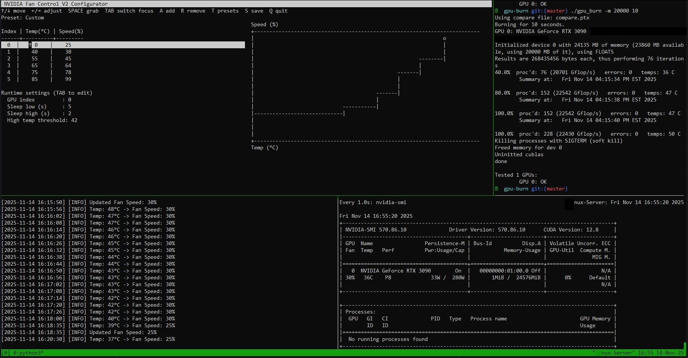

# NVIDIA Fan Control 1.0

A small, quiet fan-curve daemon for NVIDIA GPUs on Linux (NVML, systemd), with a
terminal configurator. Written to be gentle: it wakes up rarely when the GPU is
idle, and it writes to the fan controller only when a change actually matters.

> Tested only on a single-fan RTX 3090. Use at your own risk; no warranty.



## Install

```sh
./installer.sh
```

That is all. It checks for `gcc`, `make` and `python3`, builds, installs,
enables and starts the service, and writes a default config if you have none.
Re-running upgrades in place and keeps your config; an old "V2" install is
migrated automatically. No NVIDIA dev headers are needed (NVML is loaded from the
driver at runtime). Options: `--no-start`, `--configure`.

Remove with `./uninstall.sh` (keeps your config) or `./uninstall.sh --purge`.

## Use

Run from anywhere:

| Command | What it does |
|---|---|
| `nvfc` | Open the configurator (asks for sudo itself), save, and reload the daemon. |
| `nvfc status` | Live GPU temperature, fan speed, target, polling interval. |
| `nvfc logs` | Follow the daemon log. |
| `nvfc apply` | Reload an edited config file without opening the TUI. |
| `nvfc restart` | Restart the service. |
| `nvfc --version` | Print the version. |

`nvidia-fan-control` works as an alias for `nvfc`. The old `--re-configure`,
`--status`, `--restart` and `--apply` flags still work.

### The configurator
`↑/↓` pick a point, `←/→` change its temperature or speed, `TAB` switches
between temp / speed / runtime settings, `SPACE` grabs a point to reorder,
`A`/`R` add or remove points (3–7), `T` presets, `S` save, `Q` quit. In the
runtime pane, `←/→` or `SPACE` toggles **Smart Smooth**. While the daemon runs,
the plot shows a live `@` marker at the current temperature and fan speed.

## Smart Smooth

With the classic stepped curve, a point at 70 °C that jumps from 50 % to 62 %
makes the fan flip-flop whenever the GPU hovers around 69–70 °C. Smart Smooth
turns your 3–7 points into a smooth curve and keeps the fan calm:

1. **Interpolation** – straight lines between your points, so 69→70 °C is a ~1 %
   change instead of a 12 % cliff.
2. **Temperature filter** – rises are followed quickly, falls slowly, so sensor
   jitter does not move the fan.
3. **Deadband** – speed changes smaller than `deadband` % are never written.
   *This* (together with the filter) is what cuts writes to the controller;
   interpolation alone would write every degree.
4. **Held, stepped ramp-down** – a lower target must persist for `down_hold`
   seconds, then the fan drops at most `down_step` % per write. Increases are
   immediate.
5. **Emergency bypass** – at or above `emergency_temp` smoothing is skipped and
   the curve applies instantly.

Turn it off (`enabled = off`) for the classic stepped behaviour; changes are then
limited to ≥4 % steps at least 4 s apart.

## Adaptive polling

Reading the temperature is cheap; writing fan speeds is what touches the fan
controller, so the daemon minimises writes and also polls less when nothing is
happening. While the GPU is **below `high_temp_threshold`** and within ±2 °C, the
interval doubles from `sleep_low` up to `sleep_max`. Any 2 °C move, a pending
ramp-down, or temperatures at/above the threshold returns it to the fast
interval (`sleep_low`, or `sleep_high` when hot) immediately. To poll faster when
idle, lower `sleep_max`.

## Configuration

`/etc/nvidia-fan-control.conf` (or `--config <path>` / `NVFC_CONFIG_PATH`),
read at start-up and on reload (`nvfc apply` / `SIGHUP`):

```ini
[curve]
temps = 0,40,55,67,75,85       # strictly increasing, 3-7 points, 0-120 °C
speeds = 25,30,45,65,78,99     # 0-100 %

[run]
gpu_index = 0
sleep_low = 5                  # poll interval when cool (seconds)
sleep_high = 2                 # poll interval at/above high_temp_threshold
sleep_max = 10                 # longest interval when cool and stable
high_temp_threshold = 42

[smooth]
enabled = on
deadband = 3                   # ignore speed changes below this (%)
down_hold = 15                 # seconds a lower target must persist
down_step = 5                  # max % dropped per ramp-down write
emergency_temp = 85            # smoothing bypassed at/above this
```

Invalid values are clamped with a warning. An invalid curve falls back to the
built-in default curve and keeps your `[run]`/`[smooth]` options. When the service
stops, the fan is handed back to the driver's automatic control.

## Development

```sh
make USE_MOCK_NVML=1 build   # build against the mock NVML library
make test                    # run the test suite (mock GPU, no hardware)
./scripts/mock_reconfigure_drill.sh   # interactive reload drill
```

`mock_nvml/` is a fake NVML library driven by files in `$NVML_MOCK_DIR`
(`mock_nvml/mockctl.sh set-temp 70`). Fan writes are logged to
`$NVML_MOCK_DIR/fan_speed.log`. Layout: `src/` daemon, `bin/nvfc` CLI,
`tui/` configurator, `systemd/` unit, `tests/`, `docs/CHANGELOG.md`.

### Manual test demo

```sh
mkdir -p /tmp/nvfc-test
cat > /tmp/nvfc-test/test.conf <<'EOF'
[curve]
temps = 0,60,70,85
speeds = 35,50,62,99

[run]
sleep_low = 2
sleep_high = 2
sleep_max = 8
high_temp_threshold = 42

[smooth]
enabled = on
EOF
echo 69 > /tmp/nvfc-test/temperature
```

**Terminal 1.** Start the daemon and watch its log:

```sh
NVML_MOCK_DIR=/tmp/nvfc-test NVFC_STATUS_PATH=/tmp/nvfc-test/status \
  ./build/nvidia-fan-controld --config /tmp/nvfc-test/test.conf
```

**Terminal 2.** Fake the temperature by writing a number to the file, and watch the fan writes:

```sh
export NVML_MOCK_DIR=/tmp/nvfc-test
mock_nvml/mockctl.sh set-temp 70      # same as: echo 70 > /tmp/nvfc-test/temperature
mock_nvml/mockctl.sh tail-log         # each line is a real fan write
```

Handy checks:
- **Flapping test.** Run `while true; do echo 70 > /tmp/nvfc-test/temperature; sleep 2; echo 69 > /tmp/nvfc-test/temperature; sleep 2; done`. The daemon should write about once and then stay quiet.
- **Climb test.** Set 75, then 90. The fan should go up promptly, and at 90 jump straight to 99 (emergency, no smoothing).
- **Cool-down test.** Set 40. Nothing happens for about 15 s, then the fan steps down at most 5% at a time.
- **Backoff test.** Leave the temperature at 35. The status file's `interval=` value (`cat /tmp/nvfc-test/status`) climbs 2 → 4 → 8, and snaps back to 2 as soon as you raise the temperature by 2 °C.
- **Smoothing off.** Set `enabled = off` in the config and run `kill -HUP $(pgrep nvidia-fan-controld)`. The daemon reloads and switches to the old stepped behaviour.

If you'd rather skip the setup, `./scripts/mock_reconfigure_drill.sh` builds the mock and starts a daemon for you, then prints the commands to join its session. You can also run `make test` for the automated suite.

On the real GPU you don't need any of this. After `./installer.sh`, use `nvfc status` to see live temperature, fan and polling interval, and `nvfc logs` to follow the daemon's log.


## TODO
- Multi-fan control (all fans of one GPU together). Currently fan 0 only.
- Test on more GPUs.
